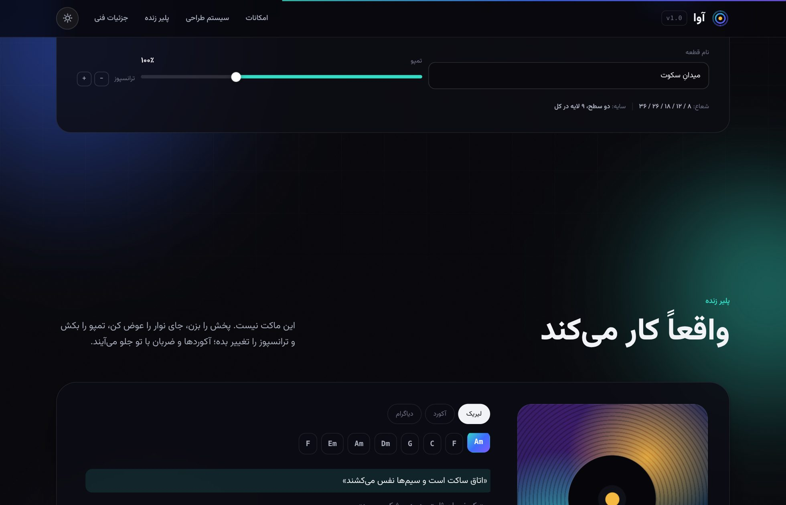
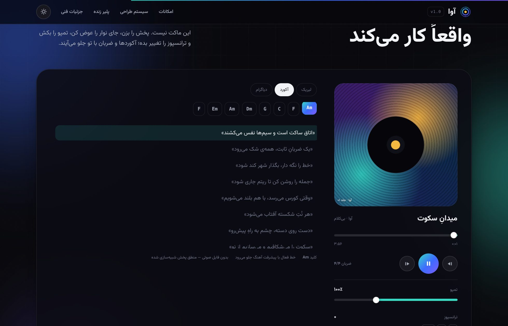
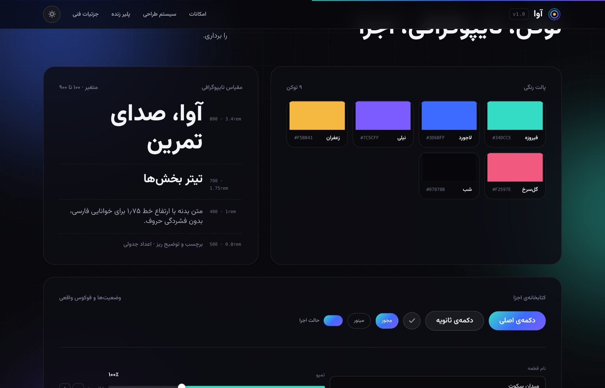

# آوا · AVA

> یک صفحه‌ی فرود تک‌فایلی، فارسی و راست‌به‌چپ، برای یک اپ تمرین موسیقی — بدون فریم‌ورک، بدون CDN، بدون تصویر بیرونی.



## چی هست؟

یک دموی طراحی و کدنویسی: کل تجربه — توکن‌های طراحی، ماکاپ دستگاه، سیستم کامپوننت‌ها و یک پلیر **واقعاً کارکننده** — در یک فایل `index.html` جمع شده. هیچ درخواست شبکه‌ای ندارد؛ فایل را دوبار کلیک کنی، کار می‌کند.

| | |
|---|---|
| **حجم کل** | ۲۵۱ کیلوبایت (gzip: ۱۳۲ کیلوبایت) |
| **جاوااسکریپت** | ۱۹ کیلوبایت خام، بدون هیچ کتابخانه |
| **CSS** | ۵۵ کیلوبایت · ~۳۱۵ قاعده |
| **وابستگی** | صفر |
| **فونت** | وزیرمتن متغیر (۱۰۰–۹۰۰)، جاسازی‌شده base64 |
| **تصاویر** | هیچ‌کدام — همه‌ی گرافیک CSS یا SVG درون‌خطی است |
| **زبان** | فارسی، `dir="rtl"`، ویژگی‌های منطقی CSS |

## اجرا

```bash
# فقط باز کن — همین
open index.html        # یا: xdg-open / دوبار کلیک

# یا با سرور محلی
npx serve .

# بیلد مجدد (جاسازی فونت + تزریق اعداد واقعی + بازرسی خروجی)
node build.mjs
```

## ساختار

```
ava/
├── index.html          ← خروجی نهایی، تک‌فایل و آماده‌ی انتشار
├── build.mjs           ← فونت را base64 می‌کند، اندازه‌های واقعی را تزریق می‌کند، خروجی را بازرسی می‌کند
├── src/
│   ├── index.html      ← منبع (با جای‌نگهدارهای __FONT_B64__ و __KB_TOTAL__)
│   └── assets/         ← فونت متغیر + مجوز OFL
├── preview/            ← اسکرین‌شات‌های واقعی از رندر مرورگر
└── dist/index.html     ← همان خروجی
```

## بخش‌ها

| بخش | چه چیزی نشان می‌دهد |
|---|---|
| **قهرمان** | تیتر با زیرخط SVG متحرک، چشم‌انداز شبیه‌سازی‌شده‌ی دستگاه، کارت‌های شناور |
| **امکانات** | شبکه‌ی Bento با ویترین‌های زنده: لیریک هم‌زمان، دیاگرام انگشت‌گذاری، مترونوم، حالت اجرا |
| **سیستم طراحی** | پالت (کلیک = کپی کد رنگ)، مقیاس تایپوگرافی، کتابخانه‌ی کامپوننت با فوکوس واقعی |
| **پلیر زنده** | پخش/توقف، جای نوار، تمپو، ترانسپوز آکوردها، سه تب (لیریک / آکورد / دیاگرام) |
| **جزئیات فنی** | نمونه‌ی ویژگی‌های منطقی CSS و چک‌لیست کیفیت |




## تصمیم‌های طراحی

- **راست‌به‌چپ اصیل.** هیچ `left`/`right` در CSS نیست؛ همه‌چیز با `inline`/`block` نوشته شده. اسلایدرها، آرک‌های آکورد و نوار پیشرفت به‌درستی از راست پر می‌شوند.
- **ارقام فارسی بدون کشیدگی.** `font-variant-numeric: tabular-nums` روی وزیرمتن ارقام فارسی را از ۷۱ به ۹۸ پیکسل پهن می‌کند، پس عمداً استفاده نشده و ارقام با تبدیل نویسه‌ای فارسی شده‌اند.
- **تم روشن و تیره از یک منبع.** فقط مقادیر متغیرهای CSS عوض می‌شود، نه استایل‌ها؛ انتخاب کاربر در `localStorage` می‌ماند.
- **صفر گرافیک بیرونی.** جلد آلبوم یک ترکیب `conic-gradient` + `radial-gradient` + خط‌های درونی است، آیکن‌ها `<symbol>` درون‌خطی، نویز یک SVG درون‌خطی.
- **حرکت با احترام.** هر انیمیشن زیر `prefers-reduced-motion` خاموش می‌شود، از جمله چرخ جلد و مترونوم.
- **دسترس‌پذیری.** لینک پرش، فوکوس مرئی، `role="tablist"`، `aria-pressed`، `aria-label` روی هر کنترل آیکنی، توست با `role="status"`.

## سازگاری

در Chromium/Firefox/WebKit مدرن تست شده. بدون سرریز افقی از ۳۲۰ تا ۱۴۴۰ پیکسل. `color-mix()` و `backdrop-filter` استفاده شده‌اند (پشتیبانی از ۲۰۲۳ به بعد).

## مجوز

کد: آزاد برای استفاده‌ی شخصی و نمونه‌کار.
فونت وزیرمتن: مجوز **SIL OFL 1.1** — متن کامل در `src/assets/Vazirmatn-OFL.txt`.
